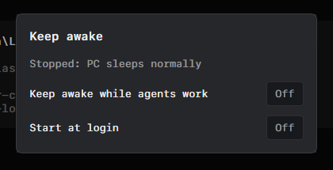

# Keep awake for Herdr

Keeps your Windows PC from sleeping while your [Herdr](https://herdr.dev) agents are working, and lets it sleep normally once they're done.



- Turn it on or off from the command palette. Nothing is added to your layout.
- It keeps the PC awake only while an agent is **working**. Agents that are idle, done, or waiting on you don't keep it awake.
- It runs in the background in herdr-core, so it keeps working after you close the Herdr window.
- Optionally starts when you log in to Windows.

## Requirements

- Windows
- [Herdr](https://herdr.dev/download/)
- PowerShell 7 (`pwsh`) on your PATH: `winget install Microsoft.PowerShell`

## Install

### Ask your agent

Inside a Herdr terminal, tell your coding agent:

```
Add the Herdr mod from https://github.com/murtuzaalisurti/herdr-keep-awake
```

Herdr's `AGENTS.md` tells it how to install shared mods.

### Manually

```pwsh
git clone https://github.com/murtuzaalisurti/herdr-keep-awake "$env:TEMP\herdr-keep-awake"
$dst = "$HOME\.config\herdr-app\mods\keep-awake"
New-Item -ItemType Directory -Force $dst | Out-Null
# Copy mod.json first so Herdr doesn't add the mod to your layout as a panel
Copy-Item "$env:TEMP\herdr-keep-awake\mods\keep-awake\mod.json" $dst
Copy-Item "$env:TEMP\herdr-keep-awake\mods\keep-awake\*" $dst -Force
herdr-app check $dst
```

The folder must be named `keep-awake`, because the mod looks for its script there.

## Use

1. Press **Ctrl+Shift+P** and run **Keep awake**.
2. Switch **Keep awake while agents work** to **On**.
3. If you want it to start every time you log in, switch **Start at login** to **On**.

The status line shows what it's doing:

| Status | Meaning |
|---|---|
| Stopped: PC sleeps normally | The background script is off |
| Running: idle, PC sleeps normally | Running, but no agent is working |
| Running: keeping PC awake (agents working) | At least one agent is working |

From a terminal:

```pwsh
hc read keep-awake   # see its log (one line every 30 s: awake / idle)
hc kill keep-awake   # stop it
```

## How it works

- **On** starts `awake.ps1` as a herdr-core terminal named `keep-awake`. It has no Herdr labels, so it doesn't appear in Herdr's window.
- Every 30 seconds the script runs `hc ls --json`. If any terminal reports `working`, it calls Windows' [`SetThreadExecutionState`](https://learn.microsoft.com/windows/win32/api/winbase/nf-winbase-setthreadexecutionstate) to keep the system awake. The display can still turn off. Otherwise it switches back to normal sleep rules.
- **Off** ends that terminal, and Windows' sleep rules apply again right away.
- **Start at login** adds `herdr-keep-awake.lnk` to your Windows Startup folder. That shortcut starts the same terminal, hidden. herdr-core won't start a second terminal named `keep-awake`, so it never runs twice.

## Limits

- Windows only.
- Closing a laptop's lid still puts it to sleep. To change that, open Control Panel → Power Options → *Choose what closing the lid does* and set "When plugged in" to *Do nothing*.
- After an agent stops working, the PC can stay awake for up to 30 more seconds.

## Uninstall

```pwsh
hc kill keep-awake
Remove-Item "$([Environment]::GetFolderPath('Startup'))\herdr-keep-awake.lnk" -ErrorAction SilentlyContinue
Remove-Item -Recurse "$HOME\.config\herdr-app\mods\keep-awake"
```

## Build it yourself

[RECIPE.md](RECIPE.md) describes the mod in enough detail that a coding agent can rebuild it from scratch or port it to another platform.

## License

[MIT](LICENSE)
