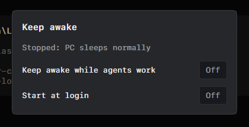

# Keep awake

Keeps your Windows PC from sleeping while Herdr agents are working, and lets it sleep normally once they stop. A small dialog, opened from the command palette, starts or stops the background watcher and toggles starting it at login. The watcher runs inside herdr-core, so it keeps working after the Herdr window is closed.

## What you see

Nothing in the layout. Command palette (Ctrl+Shift+P) → **Keep awake** opens a 380px dialog:

- Title "Keep awake", 15px semibold, `foreground`.
- A status line, 13px: `…` while loading, "Stopped: PC sleeps normally", "Running: idle, PC sleeps normally" (`muted`), or "Running: keeping PC awake (agents working)" (`working` color).
- Two rows, label on the left and an On/Off pill on the right:
  - "Keep awake while agents work"
  - "Start at login"
- Pills: On = `accent` background, `accent_foreground` text and border; Off = `surface` background, `border` border, `muted` text; `hover` background on hover; `…` while an action runs.

## How it behaves

- **Keep awake while agents work** starts or kills a herdr-core terminal named `keep-awake` running `awake.ps1`. It has no Herdr labels, so it never shows in Herdr's screens.
- `awake.ps1` checks `hc ls --json` every 30 s. If any terminal has status `working`, it calls `SetThreadExecutionState(ES_CONTINUOUS | ES_SYSTEM_REQUIRED)` (system stays awake, display may still turn off); otherwise `ES_CONTINUOUS` alone (normal sleep). Killing the terminal releases the hold.
- `blocked`, `done` and `idle` agents don't keep the PC awake.
- **Start at login** creates or removes `herdr-keep-awake.lnk` in the Windows Startup folder, which runs the same `hc run` command hidden. A second start is refused by herdr-core because the name `keep-awake` is taken, so it never runs twice.
- The dialog reads the state again after every action. The status line follows agents live.

## Built from

- `mods/keep-awake/mod.json`: `place: "none"`, `overlay: {kind: "dialog", width: 380}`, one `palette` entry running `mod.open {name: "keep-awake"}`.
- `mods/keep-awake/main.js`: a `View`; uses `hc`, `exec`, `home`, `theme`, `agents`, `checking` from `herdr`; `v_flex`/`h_flex` from `gpui-base`.
  - running: `hc get keep-awake --json` exits 0 and reports `"live"`.
  - start: `hc run --bg --no-parent --no-notify --rm --name keep-awake -- pwsh -NoProfile -File <home>\.config\herdr-app\mods\keep-awake\awake.ps1`; stop: `hc kill keep-awake`.
  - autostart: `pwsh -Command` with `Test-Path`, `WScript.Shell.CreateShortcut` (target `pwsh`, args `-NoProfile -WindowStyle Hidden -Command "hc run ..."`, window style 7) or `Remove-Item`.
- `mods/keep-awake/awake.ps1`: the watcher loop above, logging `HH:mm:ss awake|idle` (`hc read keep-awake`).

## Watch out

- Windows only, and needs PowerShell 7 (`pwsh`) on PATH.
- In pwsh 7, write the flags as `0x80000001u` / `0x80000000u`: without `u` they parse as negative Int32 and the call fails.
- `--no-parent` is required: started from inside a terminal, the watcher would otherwise end with that terminal.
- Write `mod.json` before `main.js`: if Herdr sees `main.js` first, it docks the mod into the shown layout as a 320px panel.
- The script path is hardcoded to `mods/keep-awake/`; renaming the folder means updating `script()` in `main.js`.
- Closing a laptop lid still sleeps it unless Windows' lid action is "Do nothing".

## Done when

- `herdr-app check ~/.config/herdr-app/mods/keep-awake` passes.
- Ctrl+Shift+P → "Keep awake" opens the dialog; toggling the first row On makes `hc get keep-awake` show a live terminal, Off removes it.
- With an agent working, `powercfg /requests` (admin) lists `pwsh.exe` under SYSTEM; with none working it doesn't.
- Toggling "Start at login" On creates `shell:startup\herdr-keep-awake.lnk`; Off deletes it.
